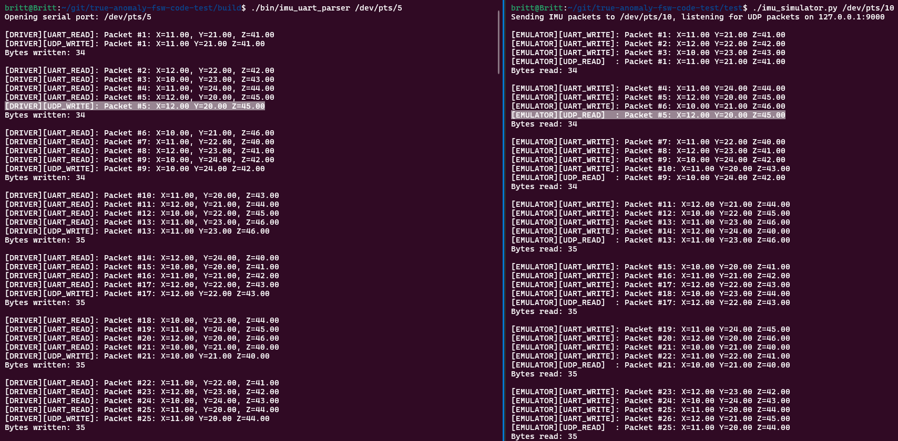

# IMU UART Parser and IMU simulator - Takehome Assignment

<!-- TOC -->

- [IMU UART Parser and IMU simulator - Takehome Assignment](#imu-uart-parser-and-imu-simulator---takehome-assignment)
    - [Prompt](#prompt)
    - [Answer to question 2 endianness:](#answer-to-question-2-endianness)
    - [Project Structure](#project-structure)
    - [How to build and run catch2 unit tests](#how-to-build-and-run-catch2-unit-tests)
    - [How to test imu_parser using socat to create two linked virtual serial ports](#how-to-test-imu_parser-using-socat-to-create-two-linked-virtual-serial-ports)
        - [In a nutshell:](#in-a-nutshell)
        - [In more detail:](#in-more-detail)
    - [FINAL PRODUCT YO: How to test c++ imu_parser with python imu_simulator.py](#final-product-yo-how-to-test-c-imu_parser-with-python-imu_simulatorpy)
        - [Terminal Output Result SUCCESS: visually verify that imu_parser parses all packets and echos every 4th packet over UDP](#terminal-output-result-success-visually-verify-that-imu_parser-parses-all-packets-and-echos-every-4th-packet-over-udp)

<!-- /TOC -->


This project simulates an IMU data stream over UART and parses packets into structured telemetry, which it broadcasts via UDP on a fixed schedule.

- Reader thread parsing and logging real-time IMU packets ✔
- Broadcaster thread firing off clean UDP packets every 80ms ✔
- Python simulator faking sensor data and receiving its own echoed output ✔
- Fully closed-loop test setup working across two protocols ✔
- Dynamic but predictable values in python script test packets ✔

##  Prompt

An IMU outputs a byte stream at `921600` baud with a packet definition described below:

| Byte offset 	| Size 	| Type 	| Description 	|
|---	|---	|---	|---	|
| 0 	| 1 	| Raw byte 	| Start of frame byte - 0x7F 	|
| 1 	| 1 	| Raw byte 	| Start of frame byte - 0xF0 	|
| 2 	| 1 	| Raw byte 	| Start of frame byte - 0x1C 	|
| 3 	| 1 	| Raw byte 	| Start of frame byte - 0xAF 	|
| 4 	| 4 	| Unsigned Integer 	| Packet count 	|
| 8 	| 4 	| Float 	| X-axis gyro rate 	|
| 12 	| 4 	| Float 	| Y-axis gyro rate 	|
| 16 	| 4 	| Float 	| Z-axis gyro rate 	|

- Assume some flavor of Linux running
- Assume data is formatted according to `IEEE-754`
- Assume network (big endian) byte order

Write the C++ code to parse data over a UART (`/dev/tty1`) and decommutate the byte stream into the four fields: 

- Packet_Count 
- X_Rate_rdps 
- Y_Rate_rdps 
- Z_Rate_rdps

What modifications, if any, would you need to make to the code from 1) if the Linux host was a little endian processor? Describe those modifications.

In Python, design a simple simulator/tester to drive your IMU parser. 

- The simulator should send a string of bytes in the proper format over the UART for your parser to accept
- The data contained in the byte string can be generated in any way of your choosing to best test the parser.
- Subsequently, it should then read the broadcasted results from 3) on the localhost network to validate the output.

##  Answer to question 2 (endianness):

No modifications are necessary (if we can assume that the IMU packets themselves really are big-endian.)

It shouldn't matter if the linux host is running on a little endian processor or a big endian processor - `htobe32()` and `be32toh()` check endianness: they swap bytes if the host is little endian, and do nothing at all if the host is big endian. That makes them portable, though I'm sure there are weird exceptions.

It works like this:

- Packet sender uses `htobe32()` to convert host byte order to network byte order (big endian) for each multi-byte field
- Packet receiver uses `be32toh()` to convert network byte order (big endian) to host byte order for each multi-byte field.
- Usually its more of a pain to do endianness conversion for floats and doubles, and the IMU packet in this case has floats.
- But since we are assuming `IEE-754` floats (4 bytes and normal formatting), I can cheat by using unions to pretend the floats are `uint32_t` so I can still use `htobe32()` and `be32toh()`.
- To see how that works, check out my my wrapper functions `f_htobe32()` and `f_be32toh()` in `include/fendian.hpp`.

`IMPORTANT NOTE`: I've been assuming that the IMU packet protocol itself is all big-endian. If that was NOT true, and it turns out that the IMU fields can be little-endian or a mix of big-endian and little-endian (gross but common), then we'd have to use `htole32()` and `le32toh()` in addition to or instead of `htobe32()` and `be32toh()`, which means also adding 2 additional wrapper functions to `fendian.hpp` for the floats: `f_htole32()` and `f_le32toh()`.

- I'm sure there would be doubles (8 bytes) too at some point, so I'd probably want to do what I've done in the past and add 4 more wrapper functions to do the same endianness byte-flipping for double packet fields (`d_htole32()`, etc, etc, etc.).

Write a C++ Linux program designed to execute in a resource constrained, multi-threaded 
environment that will execute the IMU parsing code every `80ms` and broadcast the parsed results on the localhost network.

- “execute the IMU parsing code every 80ms and broadcast the parsed results on the localhost network.”
- Does that mean “parse and broadcast as many packets as possible once every 80ms”, or "parse all packets but drop most on the floor for now and only broadcast the latest packet every 80ms"?
- Do we want one thread triggered every 80ms to read and process and forward all the packets?
- Or multiple threads - one to parse packets in the background and one to broadcast?
- Do you want them all broadcasted, or only the latest?

I wasn't sure. I decided to assume the latter and do two threads for fun - could always combine them into one 80ms thread instead, so here's what I made:

- "producer" == Thread A (UART parser running in background thread): parses packets as fast as bytes arrive but only stores the most recent one in a global struct (shared memory with thread B)

- "consumer" == Thread B (triggered every 80ms by scheduler): wakes up, grabs the latest parsed packet (shared memory with thread A), and broadcasts that to localhost

- This aligns with:
  - "resource-constrained" → no growing queues
  - Realistic embedded stuff (e.g., updating a housekeeping packet on a schedule)

`NOTE`: This could be done all sorts of ways depending on the architecture. In reality, some threads are time critical and tightly controlled with extra knobs and buttons (CPU, offset, start time, end time, priority, etc etc), and we'd probably want Linux RT.

Other considerations:

If it was a real IMU I'd want to know how many samples per second this IMU produces and how noisy it is - otherwise I don't really know how much data I'm dealing with, only the maximum possible number of packets from the baud rate.

The only other IMU I ever worked with produced 1000 samples a second and was too noisy even after configuring the IMU to average its data internally, so we had to average/process it again to get rid of the noise and get it down to 10Hz for GNC's 10Hz flight control model (Nyquist theorem stuff.) There was too much latency to do that in software for the flight computer, so I did it on the SOC's FPGA.

GNC would probably get only the most recent telemetry point when the FCSW model steps, and I'd likely have configurable data rates for all other downlink/storage destinations - high rates for gathering data and debugging, lower data rates for historical telemetry, and all configurable to different rates for different situations.

It all depends on what mission operations and GNC folks want.

##  Project Structure

- `src/` → C++ source code
- `include/` → C++ headers
- `test/` → catch2 unit tests (`imu_simulator.py`) and `imu_simulator.py`
- `build/` → CMake build output (gitignored), the `bin` directory has the `unit_tests` and `imu_parser` executables

##  How to build and run catch2 unit tests

Everything:

```bash
mkdir -p build
cd build
cmake ..
make
```

Just unit tests:

```bash
cd build
cmake ..
make unit_tests
./bin/unit_tests
Randomness seeded to: 1089831589
===============================================================================
All tests passed (1 assertion in 1 test case)
```

##  How to test `imu_parser` using `socat` to create two linked virtual serial ports

A `pty` is a `pseudoterminal` (fake serial port) when we don't have access to an actual hardware terminal serial port (`tty`).

We are creating two linked virtual serial ports like this:

```bash
/dev/pts/5  <==>  /dev/pts/7
[imu_uart_parser]      [python or echo]
```

Anything written to one side will show up on the other side.

To test this we need 3 terminal windows.

###  In a nutshell:

```bash
# Terminal 1: socat to created two linked PTYs (virtual serial ports TX/RX)
socat -d -d pty,raw,echo=0 pty,raw,echo=0

# Note the two PTY paths it prints
N PTY is /dev/pts/5 # choose this as RX (driver reads from it)
N PTY is /dev/pts/7 # choose this as TX (emulator writes to it)

# Terminal 2: Run C++ UART IMU parser (device under test: basically IMU driver, but doesn't command, only receives telemetry)
./bin/imu_uart_parser /dev/pts/5 # driver reads from /dev/pts/5, finds sync, parses packets, and broadcasts them.

# Terminal 3: Send fake IMU packets (will be imu_simulator.py UART output)
echo -ne '\x7f\xf0\x1c\xaf\x00\x00\x00\x01\x41\x20\x00\x00\x41\xa0\x00\x00\x42\x20\x00\x00' > /dev/pts/7

# Terminal 4: print UDP telemetry packets broadcast from driver (will be python_simulator.py UDP input)
netcat -ul 9000
```

###  5.2. In more detail:

In `terminal 1`: create two linked virtual serial ports:

```bash
# Use `socat` to create two virtual terminals and connect them together.
$ socat -d -d pty,raw,echo=0 pty,raw,echo=0
2025/05/05 21:51:00 socat[82065] N PTY is /dev/pts/5
2025/05/05 21:51:00 socat[82065] N PTY is /dev/pts/7 
2025/05/05 21:51:00 socat[82065] N starting data transfer loop with FDs [5,5] and [7,7]
```

`socat` arguments in this case:

- `-d -d` prints verbose info (like `PTY` names)
- `pty` allocates a pseudoterminal (like `/dev/pts/3`)
- `raw` means no line buffering or special character handling, just raw bytes
- `echo=0` means don't echo back what you send (avoids byte duplication)

In `terminal 2`: connect `imu_uart_parser` to one side:

```bash
# run the imu_uart_parser program with the first PTY
$ ./build/bin/imu_uart_parser /dev/pts/5
Opening serial port: /dev/pts/5
```

In `terminal 3`: write simulated IMU data bytes to the other side:

```bash
# write simulated data bytes to the first PTY by echoing them to the second PTY:
$ echo -ne '\x7f\xf0\x1c\xaf\x00\x00\x00\x01\x41\x20\x00\x00\x41\xa0\x00\x00\x42\x20\x00\x00' > /dev/pts/7
```

The simulated IMU data bytes will show up in `terminal 1`:

```bash
Read 20 bytes: 7F F0 1C AF 00 00 00 01 41 20 00 00 41 A0 00 00 42 20 00 00
```

##  FINAL PRODUCT YO: How to test c++ `imu_parser` with python `imu_simulator.py`

Replace terminal 3 echo and terminal 4 netcat with a single terminal that calls the python script in `/test/imu_simulator.py`:

```bash
# Terminal 1: socat to created two linked PTYs (virtual serial ports TX/RX)
socat -d -d pty,raw,echo=0 pty,raw,echo=0

# Note the two PTY paths it prints
N PTY is /dev/pts/5 # choose this as RX (driver reads from it)
N PTY is /dev/pts/7 # choose this as TX (emulator writes to it)

# Terminal 2: Run C++ UART IMU parser (device under test: basically IMU driver, but doesn't command, only receives telemetry)
./bin/imu_uart_parser /dev/pts/5 # driver reads from /dev/pts/5, finds sync, parses packets, and broadcasts them.

# Terminal 3: Run python IMU simulator: Sends fake IMU packets over UART, receives UDP with parsed packet strings from localhost:9000 

# assuming you're in `/test/` directory of repo:
python3 imu_simulator.py /dev/pts/7 # replace this with second PTY argument you got in terminal 1

or:

python3 imu_simulator.py /dev/pts/7 --udp_port 9100 # optional
```

###  Terminal Output Result SUCCESS: visually verify that imu_parser parses all packets and echos every 4th packet over UDP

Right now the IMU simulator has a 20ms period (50Hz) and the IMU parser has an 80ms period (12.5Hz).

That means that although the imu parser parses all packets from the UART, only every 4th packet is broadcast back over UDP to the simulator.

After modifying the parser python to read using a nonblocking UDP port and `select()` and actually execute every 20ms, that is what we see:



Here's text results:

`imu_parser.py` parses simulator packets from UART bytestream in one thread and echos the most recent one back over UDP in a second thread that runs once every 80ms. That ends up being only every 4th packet because the simulator sends a packet every 20ms.


```bash
britt@Britt:~/git/true-anomaly-fsw-code-test/build$ ./bin/imu_uart_parser /dev/pts/5
Opening serial port: /dev/pts/5

[DRIVER][UART_READ]: Packet #1: X=11.00, Y=21.00, Z=41.00
[DRIVER][UDP_WRITE]: Packet #1: X=11.00 Y=21.00 Z=41.00
Bytes written: 34

[DRIVER][UART_READ]: Packet #2: X=12.00, Y=22.00, Z=42.00
[DRIVER][UART_READ]: Packet #3: X=10.00, Y=23.00, Z=43.00
[DRIVER][UART_READ]: Packet #4: X=11.00, Y=24.00, Z=44.00
[DRIVER][UART_READ]: Packet #5: X=12.00, Y=20.00, Z=45.00
[DRIVER][UDP_WRITE]: Packet #5: X=12.00 Y=20.00 Z=45.00
Bytes written: 34

[DRIVER][UART_READ]: Packet #6: X=10.00, Y=21.00, Z=46.00
[DRIVER][UART_READ]: Packet #7: X=11.00, Y=22.00, Z=40.00
[DRIVER][UART_READ]: Packet #8: X=12.00, Y=23.00, Z=41.00
[DRIVER][UART_READ]: Packet #9: X=10.00, Y=24.00, Z=42.00
[DRIVER][UDP_WRITE]: Packet #9: X=10.00 Y=24.00 Z=42.00
Bytes written: 34

[DRIVER][UART_READ]: Packet #10: X=11.00, Y=20.00, Z=43.00
[DRIVER][UART_READ]: Packet #11: X=12.00, Y=21.00, Z=44.00
[DRIVER][UART_READ]: Packet #12: X=10.00, Y=22.00, Z=45.00
[DRIVER][UART_READ]: Packet #13: X=11.00, Y=23.00, Z=46.00
[DRIVER][UDP_WRITE]: Packet #13: X=11.00 Y=23.00 Z=46.00
Bytes written: 35
```

And `imu_simulator.py` simulator writes packet every 20ms and gets a UDP response back for every 4th packet:

```bash
britt@Britt:~/git/true-anomaly-fsw-code-test/test$ ./imu_simulator.py /dev/pts/10
Sending IMU packets to /dev/pts/10, listening for UDP packets on 127.0.0.1:9000

[EMULATOR][UART_WRITE]: Packet #1: X=11.00 Y=21.00 Z=41.00
[EMULATOR][UART_WRITE]: Packet #2: X=12.00 Y=22.00 Z=42.00
[EMULATOR][UART_WRITE]: Packet #3: X=10.00 Y=23.00 Z=43.00
[EMULATOR][UDP_READ]  : Packet #1: X=11.00 Y=21.00 Z=41.00
Bytes read: 34

[EMULATOR][UART_WRITE]: Packet #4: X=11.00 Y=24.00 Z=44.00
[EMULATOR][UART_WRITE]: Packet #5: X=12.00 Y=20.00 Z=45.00
[EMULATOR][UART_WRITE]: Packet #6: X=10.00 Y=21.00 Z=46.00
[EMULATOR][UDP_READ]  : Packet #5: X=12.00 Y=20.00 Z=45.00
Bytes read: 34

[EMULATOR][UART_WRITE]: Packet #7: X=11.00 Y=22.00 Z=40.00
[EMULATOR][UART_WRITE]: Packet #8: X=12.00 Y=23.00 Z=41.00
[EMULATOR][UART_WRITE]: Packet #9: X=10.00 Y=24.00 Z=42.00
[EMULATOR][UART_WRITE]: Packet #10: X=11.00 Y=20.00 Z=43.00
[EMULATOR][UDP_READ]  : Packet #9: X=10.00 Y=24.00 Z=42.00
Bytes read: 34

[EMULATOR][UART_WRITE]: Packet #11: X=12.00 Y=21.00 Z=44.00
[EMULATOR][UART_WRITE]: Packet #12: X=10.00 Y=22.00 Z=45.00
[EMULATOR][UART_WRITE]: Packet #13: X=11.00 Y=23.00 Z=46.00
[EMULATOR][UART_WRITE]: Packet #14: X=12.00 Y=24.00 Z=40.00
[EMULATOR][UDP_READ]  : Packet #13: X=11.00 Y=23.00 Z=46.00
Bytes read: 35

[EMULATOR][UART_WRITE]: Packet #15: X=10.00 Y=20.00 Z=41.00
[EMULATOR][UART_WRITE]: Packet #16: X=11.00 Y=21.00 Z=42.00
[EMULATOR][UART_WRITE]: Packet #17: X=12.00 Y=22.00 Z=43.00
[EMULATOR][UART_WRITE]: Packet #18: X=10.00 Y=23.00 Z=44.00
[EMULATOR][UDP_READ]  : Packet #17: X=12.00 Y=22.00 Z=43.00
Bytes read: 35

[EMULATOR][UART_WRITE]: Packet #19: X=11.00 Y=24.00 Z=45.00
[EMULATOR][UART_WRITE]: Packet #20: X=12.00 Y=20.00 Z=46.00
[EMULATOR][UART_WRITE]: Packet #21: X=10.00 Y=21.00 Z=40.00
[EMULATOR][UART_WRITE]: Packet #22: X=11.00 Y=22.00 Z=41.00
[EMULATOR][UDP_READ]  : Packet #21: X=10.00 Y=21.00 Z=40.00
Bytes read: 35

[EMULATOR][UART_WRITE]: Packet #23: X=12.00 Y=23.00 Z=42.00
[EMULATOR][UART_WRITE]: Packet #24: X=10.00 Y=24.00 Z=43.00
[EMULATOR][UART_WRITE]: Packet #25: X=11.00 Y=20.00 Z=44.00
[EMULATOR][UART_WRITE]: Packet #26: X=12.00 Y=21.00 Z=45.00
[EMULATOR][UDP_READ]  : Packet #25: X=11.00 Y=20.00 Z=44.00
Bytes read: 35

[EMULATOR][UART_WRITE]: Packet #27: X=10.00 Y=22.00 Z=46.00
[EMULATOR][UART_WRITE]: Packet #28: X=11.00 Y=23.00 Z=40.00
[EMULATOR][UART_WRITE]: Packet #29: X=12.00 Y=24.00 Z=41.00
[EMULATOR][UART_WRITE]: Packet #30: X=10.00 Y=20.00 Z=42.00
[EMULATOR][UDP_READ]  : Packet #29: X=12.00 Y=24.00 Z=41.00
Bytes read: 35
```

